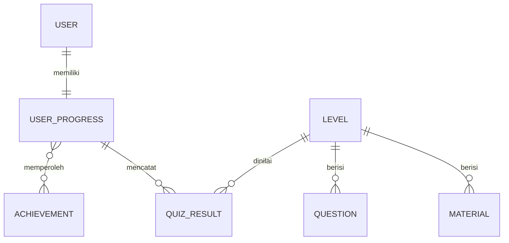
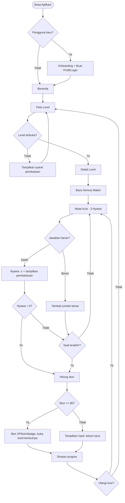
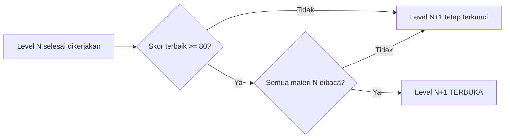

# 🚀 InfoQuest — Petualangan Informatika

> Aplikasi mobile berbasis **Flutter** yang mengubah belajar Informatika menjadi petualangan bergaya permainan: selesaikan level, kumpulkan XP, buka lencana, dan jaga streak belajar.

**Status dokumen:** Perencanaan (v1.0) · **Platform target:** Android (iOS opsional) · **Bahasa:** Indonesia

---

## Daftar Isi

1. [Gambaran Umum Aplikasi](#1-gambaran-umum-aplikasi)
2. [Konsep Gamifikasi](#2-konsep-gamifikasi)
3. [Struktur Level Pembelajaran](#3-struktur-level-pembelajaran)
4. [Fitur Utama Aplikasi](#4-fitur-utama-aplikasi)
5. [Desain UI/UX](#5-desain-uiux)
6. [Teknologi yang Digunakan](#6-teknologi-yang-digunakan)
7. [Arsitektur dan Struktur Folder](#7-arsitektur-dan-struktur-folder)
8. [Perancangan Data](#8-perancangan-data)
9. [Alur Permainan](#9-alur-permainan)
10. [Aturan dan Logika Permainan](#10-aturan-dan-logika-permainan)
11. [Tahapan Pengembangan](#11-tahapan-pengembangan)
12. [Pengujian](#12-pengujian)
13. [Kesimpulan dan Rencana Berikutnya](#13-kesimpulan-dan-rencana-berikutnya)

---

## 1. Gambaran Umum Aplikasi

### 1.1 Nama dan Deskripsi

**InfoQuest — Petualangan Informatika.** Pengguna berperan sebagai "Penjelajah Digital" yang menaklukkan 10 level, masing-masing mewakili satu topik Informatika. Setiap level berisi materi singkat, kuis, dan tantangan interaktif. Level berikutnya hanya terbuka bila level sebelumnya lulus.

### 1.2 Tujuan Aplikasi

| No | Tujuan |
|----|--------|
| 1 | Menyediakan media belajar Informatika yang interaktif dan tidak membosankan. |
| 2 | Membangun kebiasaan belajar rutin melalui streak, XP, dan penghargaan. |
| 3 | Memastikan penguasaan konsep lewat syarat kelulusan (nilai minimal 80). |
| 4 | Memberi umpan balik langsung berupa pembahasan setiap jawaban. |
| 5 | Memantau perkembangan belajar melalui statistik dan riwayat. |

### 1.3 Target Pengguna

- Pelajar SMP/SMA/SMK (usia ± 12–18 tahun) yang mempelajari Informatika.
- Pelajar yang belajar mandiri di luar kelas.
- **Opsional (pengembangan lanjut):** guru sebagai pemantau progres siswa.

### 1.4 Keunikan Aplikasi

- **Peta petualangan linear** — level ditampilkan sebagai jalur, bukan daftar biasa.
- **Gerbang kelulusan** — level terkunci sampai nilai ≥ 80 dan materi tuntas dibaca.
- **Anti-farming reward** — hadiah hanya diberikan untuk peningkatan skor, bukan pengulangan.
- **Mode offline-first** — seluruh materi dan progres dasar tersimpan lokal, tanpa wajib internet.
- **Pembahasan pada setiap soal** — salah menjawab menjadi kesempatan belajar.

---

## 2. Konsep Gamifikasi

### 2.1 Ringkasan Elemen

| Elemen | Fungsi | Aturan Singkat |
|--------|--------|----------------|
| **Level** | Struktur belajar bertahap | 10 level, berurutan, terkunci sampai syarat terpenuhi |
| **XP** | Mengukur penguasaan & menentukan peringkat | +10 XP per jawaban benar (hanya untuk peningkatan skor terbaik) |
| **Koin** | Mata uang penghargaan | +5 koin per jawaban benar (aturan sama dengan XP); dipakai untuk membeli bantuan |
| **Bintang** | Penilaian per level | ≥80 = ⭐, ≥90 = ⭐⭐, 100 = ⭐⭐⭐ |
| **Badge** | Lencana pencapaian | Diberikan sekali per pencapaian |
| **Streak** | Konsistensi harian | +1 per hari bila menyelesaikan minimal 1 kuis |
| **Progress bar** | Visualisasi kemajuan | Progres per level & progres keseluruhan |
| **Nyawa (❤️)** | Tekanan permainan | 3 nyawa per percobaan kuis; salah = −1 |
| **Leaderboard** | Kompetisi sehat | *Opsional*, fase lanjutan (butuh Firebase) |

### 2.2 Sistem Level

Level dimainkan berurutan. Level *N+1* terbuka bila **seluruh** syarat berikut terpenuhi:

1. Level *N* lulus (skor terbaik ≥ 80).
2. Seluruh bagian materi Level *N* sudah dibuka/dibaca (dicatat otomatis).

Level 1 selalu terbuka. Level 10 (Tantangan Akhir) membutuhkan Level 1–9 lulus.

### 2.3 Sistem XP dan Koin

- **XP** dihitung dari *selisih* skor terbaik (lihat [bagian 10](#10-aturan-dan-logika-permainan)).
- **Peringkat pengguna** berdasarkan total XP:

| Peringkat | Total XP |
|-----------|----------|
| Pemula Digital | 0 – 299 |
| Penjelajah | 300 – 699 |
| Pemecah Masalah | 700 – 1.199 |
| Programmer Muda | 1.200 – 1.799 |
| Master Informatika | ≥ 1.800 |

### 2.4 Sistem Badge

| Badge | Syarat | Hadiah |
|-------|--------|--------|
| 🥇 Langkah Pertama | Lulus Level 1 | +30 XP |
| 🧠 Berpikir Komputasional | Lulus Level 2 | +30 XP |
| ⭐ Sempurna! | Skor 100 pada level mana pun | +50 XP |
| 🔥 Konsisten 3 | Streak 3 hari | +20 XP |
| 🔥🔥 Konsisten 7 | Streak 7 hari | +50 XP, +25 koin |
| 📚 Kutu Buku | Membaca seluruh materi di 5 level | +40 XP |
| 💪 Pantang Menyerah | Lulus level setelah gagal ≥ 3 kali | +30 XP |
| 🏆 Penakluk Informatika | Lulus Level 10 | +150 XP, +100 koin |

Setiap badge hanya dapat diperoleh **sekali**.

### 2.5 Streak

- Hari dihitung berdasarkan zona waktu perangkat.
- Streak bertambah bila ada ≥ 1 kuis yang diselesaikan (lulus maupun tidak) pada hari itu.
- Streak direset ke 0 bila satu hari penuh terlewat.
- Bonus XP harian saat kuis pertama hari itu: `5 × min(streak, 7)`.

### 2.6 Nyawa

- Setiap percobaan kuis dimulai dengan **3 nyawa**.
- Jawaban salah mengurangi 1 nyawa. Nyawa habis → percobaan gagal, pengguna melihat pembahasan lalu dapat mengulang.
- Karena kelulusan 80%, pada kuis 10 soal pengguna maksimal salah 2 — selaras dengan 3 nyawa (nyawa habis pada kesalahan ke-3).
- Nyawa tidak dibawa antarpercobaan (reset setiap percobaan baru), sehingga tidak perlu timer isi ulang.

### 2.7 Leaderboard (Opsional)

Papan peringkat mingguan berdasarkan total XP, memerlukan Firebase Auth + Firestore. Tidak termasuk MVP.

---

## 3. Struktur Level Pembelajaran

| Level | Topik | Tujuan Pembelajaran | Materi | Soal | Tantangan | Lulus | Hadiah Pertama Lulus |
|-------|-------|--------------------|--------|------|-----------|-------|----------------------|
| 1 | Pengenalan Informatika | Memahami ruang lingkup & peran informatika | 3 | 10 | Cocokkan istilah | 80 | 50 XP, 25 koin |
| 2 | Berpikir Komputasional | Menerapkan dekomposisi, pola, abstraksi, algoritma | 4 | 10 | Urutkan langkah penyelesaian | 80 | 50 XP, 25 koin |
| 3 | Algoritma dan Pemrograman | Membaca flowchart, variabel, percabangan, perulangan | 5 | 10 | Susun blok kode | 80 | 60 XP, 30 koin |
| 4 | Struktur Data Dasar | Memahami array, list, stack, queue | 4 | 10 | Simulasi push/pop | 80 | 60 XP, 30 koin |
| 5 | Sistem Komputer | Mengenal hardware, software, OS, memori | 4 | 10 | Seret komponen ke tempatnya | 80 | 60 XP, 30 koin |
| 6 | Jaringan Komputer dan Internet | Memahami topologi, IP, protokol, DNS | 5 | 10 | Hubungkan perangkat | 80 | 70 XP, 35 koin |
| 7 | Basis Data | Memahami tabel, kunci, relasi, query dasar | 4 | 10 | Studi kasus tabel siswa | 80 | 70 XP, 35 koin |
| 8 | Keamanan Digital | Mengenali ancaman, kata sandi kuat, phishing | 4 | 10 | Deteksi pesan phishing | 80 | 70 XP, 35 koin |
| 9 | Data dan Kecerdasan Buatan | Memahami data, analisis, konsep AI & etika | 4 | 10 | Klasifikasi sederhana | 80 | 80 XP, 40 koin |
| 10 | Tantangan Akhir Informatika | Integrasi seluruh topik | 1 (rangkuman) | 20 | Studi kasus campuran | 80 | 150 XP, 100 koin |

**Catatan penyesuaian:** jumlah level, soal, dan nilai kelulusan disimpan di data (`levels.json`), bukan hardcode, sehingga mudah diubah. Tingkat kesulitan soal: Level 1–3 *mudah*, 4–7 *sedang*, 8–10 *menantang*.

**Contoh isi per level (Level 3 — Algoritma dan Pemrograman):**

- *Materi:* pengertian algoritma, flowchart, variabel & tipe data, percabangan, perulangan.
- *Kuis:* 10 soal pilihan ganda (4 opsi, 1 jawaban benar, disertai pembahasan).
- *Tantangan:* pengguna menyusun potongan blok kode agar program menampilkan bilangan 1–5.

---

## 4. Fitur Utama Aplikasi

### 4.1 Tabel Ringkas Fitur

| No | Fitur | Prioritas | Fase |
|----|-------|-----------|------|
| 1 | Splash screen | Sedang | MVP |
| 2 | Onboarding | Sedang | MVP |
| 3 | Registrasi & login | Rendah (lokal dulu) | MVP: profil lokal; Fase 2: Firebase |
| 4 | Beranda/dashboard | Tinggi | MVP |
| 5 | Peta level | Tinggi | MVP |
| 6 | Detail level | Tinggi | MVP |
| 7 | Halaman materi | Tinggi | MVP |
| 8 | Kuis pilihan ganda | Tinggi | MVP |
| 9 | Tantangan/mini-game | Sedang | MVP (1 jenis), Fase 2 (variasi) |
| 10 | Hasil & pembahasan | Tinggi | MVP |
| 11 | Profil | Sedang | MVP |
| 12 | Riwayat pembelajaran | Sedang | MVP |
| 13 | Statistik | Sedang | MVP sederhana |
| 14 | Koleksi badge | Sedang | MVP |
| 15 | Pengaturan | Rendah | MVP |

### 4.2 Detail Fitur

**Splash Screen** — Menampilkan logo & nama aplikasi 1–2 detik sambil memuat data lokal. Setelah itu: pengguna baru → Onboarding; pengguna lama → Beranda.

**Onboarding** — 3 halaman geser (cara kerja level, XP & badge, syarat lulus 80). Berakhir di pembuatan profil/login. Status "sudah onboarding" disimpan agar tidak muncul lagi.

**Registrasi dan Login** — *MVP:* pengguna memasukkan nama panggilan & memilih avatar, data tersimpan lokal. *Fase 2:* Firebase Authentication (email/kata sandi atau Google) agar progres tersinkron antarperangkat. Validasi: email valid, kata sandi ≥ 8 karakter.

**Beranda** — Menampilkan sapaan, total XP & peringkat, streak, tombol "Lanjutkan Belajar" (menuju level aktif), progres keseluruhan, dan badge terbaru. Terhubung ke Peta Level, Profil, dan Statistik.

**Peta Level** — Jalur vertikal 10 node. Status node: 🔒 terkunci, ▶ terbuka/aktif, ✅ lulus (dengan bintang). Mengetuk node terbuka → Detail Level; node terkunci → pesan syarat pembukaan.

**Detail Level** — Judul, tujuan pembelajaran, daftar materi (dengan centang dibaca), jumlah soal, nilai terbaik, bintang, hadiah. Tombol: *Baca Materi*, *Mulai Kuis* (aktif setelah semua materi dibuka).

**Halaman Materi** — Konten per bagian (teks, gambar, contoh kode), navigasi sebelumnya/berikutnya, penanda otomatis "dibaca" ketika bagian dibuka hingga akhir.

**Kuis Pilihan Ganda** — Satu soal per layar, indikator nyawa ❤️❤️❤️, progress soal (mis. 4/10), 4 opsi. Setelah memilih: umpan balik visual benar (hijau) / salah (merah + getar) lalu tombol *Lanjut*.

**Tantangan/Mini-game** — Soal berbasis kasus: urutkan langkah, seret-dan-lepas, atau susun blok kode. Memberi XP bonus tetap (+20 XP sekali per level).

**Hasil Kuis dan Pembahasan** — Skor, bintang, XP/koin yang diperoleh, badge baru (jika ada), daftar soal dengan jawaban benar & pembahasan. Tombol: *Ulangi*, *Level Berikutnya* (jika lulus), *Kembali ke Peta*.

**Profil** — Avatar, nama, peringkat, total XP, koin, streak terpanjang, jumlah badge.

**Riwayat Pembelajaran** — Daftar percobaan kuis (tanggal, level, skor, lulus/tidak).

**Statistik** — Grafik skor per level, akurasi rata-rata, total waktu/percobaan, kalender streak.

**Koleksi Badge** — Grid badge: terbuka berwarna, terkunci abu-abu dengan petunjuk syarat.

**Pengaturan** — Suara & getar (on/off), pengingat belajar harian (opsional), reset progres (dengan konfirmasi), tentang aplikasi.

---

## 5. Desain UI/UX

### 5.1 Prinsip Desain

- Material 3, sudut membulat (radius 16–24), ruang putih cukup, sentuhan ≥ 48×48 dp.
- Navigasi sederhana: **bottom navigation** 4 tab — *Beranda · Peta · Badge · Profil*.
- Mendukung tema terang & gelap; kontras teks minimal rasio 4,5:1.
- Responsif: gunakan `LayoutBuilder`/`MediaQuery`; layout tetap nyaman dari layar 360 dp hingga tablet.
- Animasi ringan (≤ 400 ms): *confetti* saat lulus, getar & goyang saat jawaban salah.

### 5.2 Palet dan Tipografi

| Peran | Warna | Hex |
|-------|-------|-----|
| Primer | Indigo | `#4F46E5` |
| Sekunder | Teal | `#14B8A6` |
| Aksen (XP/koin) | Amber | `#F59E0B` |
| Benar | Hijau | `#22C55E` |
| Salah | Merah | `#EF4444` |
| Terkunci | Abu-abu | `#9CA3AF` |
| Latar (terang) | Putih keabuan | `#F8FAFC` |

Tipografi: **Poppins** (judul) dan **Inter** (isi) melalui paket `google_fonts`, atau font bawaan bila ingin offline penuh.

### 5.3 Rancangan Tiap Halaman

| Halaman | Komponen UI Utama | Navigasi Keluar |
|---------|-------------------|-----------------|
| Splash | Logo, indikator memuat | Onboarding / Beranda |
| Onboarding | `PageView`, indikator titik, tombol Lewati/Lanjut | Registrasi/Login |
| Registrasi/Login | `TextFormField`, tombol, pilihan avatar | Beranda |
| Beranda | Kartu sapaan, `XpBar`, `StreakChip`, tombol Lanjutkan, kartu progres | Peta, Detail Level |
| Peta Level | `ListView` node jalur, `LevelNode` (terkunci/terbuka/lulus) | Detail Level |
| Detail Level | Header level, daftar materi (`CheckboxListTile`), kartu hadiah, tombol aksi | Materi, Kuis |
| Materi | `PageView`/scroll konten, progres bagian | Detail Level |
| Kuis | `LinearProgressIndicator`, ikon nyawa, `AnswerOption` ×4 | Hasil |
| Mini-game | Area seret-lepas / susun blok, tombol Periksa | Hasil |
| Hasil | Skor besar, bintang animasi, ringkasan hadiah, daftar pembahasan | Peta / Kuis ulang |
| Profil | Avatar, statistik singkat, tombol Pengaturan | Pengaturan, Riwayat |
| Riwayat | `ListView` kartu percobaan | Detail hasil |
| Statistik | Grafik batang (`fl_chart`, opsional), kartu angka | — |
| Koleksi Badge | `GridView` `BadgeTile` | Detail badge (bottom sheet) |
| Pengaturan | `SwitchListTile`, tombol reset | — |

### 5.4 Komponen Reusable

`LevelNode`, `LevelCard`, `XpBar`, `StreakChip`, `HeartIndicator`, `AnswerOption`, `BadgeTile`, `ResultStarRating`, `PrimaryButton`, `LockedOverlay`.

---

## 6. Teknologi yang Digunakan

| Teknologi | Fungsi | Rekomendasi Versi Awal (MVP) |
|-----------|--------|------------------------------|
| **Flutter** | Framework UI lintas platform | Stable channel terbaru |
| **Dart** | Bahasa pemrograman | Mengikuti versi Flutter |
| **Material 3** | Komponen antarmuka | `useMaterial3: true` |
| **Riverpod** (atau Provider) | State management | Riverpod: lebih mudah diuji; Provider: lebih sederhana untuk pemula |
| **SharedPreferences** | Menyimpan progres sederhana (JSON) | Dipakai penuh di MVP |
| **Firebase Auth** | Autentikasi | **Fase 2** |
| **Cloud Firestore** | Sinkronisasi progres & leaderboard | **Fase 2** |

**Rekomendasi implementasi versi awal:**

- MVP berjalan **sepenuhnya lokal**: materi & soal dari file JSON di `assets/`, progres di SharedPreferences. Tanpa Firebase, aplikasi tetap lengkap.
- Gunakan **satu** state management saja (disarankan Riverpod). Jangan mencampur Provider dan Riverpod.
- Paket tambahan yang diizinkan karena ada alasan jelas: `google_fonts` (tipografi), `confetti` (animasi lulus), `fl_chart` (statistik). Tidak ada paket lain tanpa kebutuhan nyata.
- Jika data tumbuh besar atau perlu kueri kompleks, evaluasi `sqflite`/`drift` di fase berikutnya (bukan MVP).

---

## 7. Arsitektur dan Struktur Folder

Pola: **layered sederhana** (UI → State → Service → Data), dengan logika permainan terpisah dari widget agar mudah diuji.

```text
infoquest/
├── assets/
│   ├── data/
│   │   ├── levels.json
│   │   ├── materials/        # level_01.json ... level_10.json
│   │   └── questions/        # level_01.json ... level_10.json
│   ├── images/
│   └── icons/
├── lib/
│   ├── main.dart
│   ├── app.dart                      # MaterialApp, tema, routing
│   ├── screens/
│   │   ├── splash/
│   │   ├── onboarding/
│   │   ├── auth/
│   │   ├── home/
│   │   ├── level_map/
│   │   ├── level_detail/
│   │   ├── material/
│   │   ├── quiz/
│   │   ├── challenge/
│   │   ├── result/
│   │   ├── profile/
│   │   ├── history/
│   │   ├── statistics/
│   │   ├── achievements/
│   │   └── settings/
│   ├── widgets/                      # komponen reusable
│   ├── models/
│   │   ├── user.dart
│   │   ├── level.dart
│   │   ├── material_section.dart
│   │   ├── question.dart
│   │   ├── quiz_result.dart
│   │   ├── user_progress.dart
│   │   └── achievement.dart
│   ├── services/
│   │   ├── storage_service.dart      # SharedPreferences
│   │   ├── content_service.dart      # baca JSON assets
│   │   ├── game_engine.dart          # logika XP, kelulusan, unlock
│   │   ├── achievement_service.dart
│   │   └── auth_service.dart         # Fase 2 (Firebase)
│   ├── providers/
│   │   ├── progress_provider.dart
│   │   ├── quiz_provider.dart
│   │   ├── user_provider.dart
│   │   └── settings_provider.dart
│   ├── data/
│   │   └── achievement_definitions.dart
│   └── utils/
│       ├── constants.dart            # PASS_SCORE, XP_PER_CORRECT, dll.
│       ├── app_theme.dart
│       ├── routes.dart
│       └── helpers.dart
├── test/
│   ├── game_engine_test.dart
│   ├── progress_provider_test.dart
│   └── widget_test.dart
└── pubspec.yaml
```

| Folder | Tanggung Jawab |
|--------|----------------|
| `screens` | Halaman utuh; hanya merangkai widget & membaca state. |
| `widgets` | Komponen UI reusable tanpa logika bisnis. |
| `models` | Struktur data + `fromJson`/`toJson`. |
| `services` | Akses penyimpanan, pembacaan aset, dan **GameEngine** (aturan permainan murni, mudah diuji). |
| `providers` | Menjembatani UI dengan service; menyimpan state aplikasi. |
| `data` | Definisi statis (mis. daftar badge). |
| `utils` | Konstanta aturan, tema, rute, helper. |

---

## 8. Perancangan Data

### 8.1 Model dan Atribut

**User**

| Atribut | Tipe | Keterangan |
|---------|------|-----------|
| `id` | String | UUID lokal / UID Firebase |
| `name` | String | Nama panggilan |
| `avatar` | String | Kode avatar |
| `createdAt` | DateTime | Tanggal pembuatan |

**Level**

| Atribut | Tipe | Keterangan |
|---------|------|-----------|
| `id` | int | Nomor level (1–10) |
| `title` | String | Judul |
| `objective` | String | Tujuan pembelajaran |
| `questionCount` | int | Jumlah soal |
| `passScore` | int | Nilai kelulusan (default 80) |
| `rewardXp` / `rewardCoins` | int | Hadiah lulus pertama |
| `difficulty` | String | `mudah`/`sedang`/`menantang` |

**Materi (MaterialSection)**

| Atribut | Tipe | Keterangan |
|---------|------|-----------|
| `id` | String | mis. `l3_m2` |
| `levelId` | int | FK → Level |
| `order` | int | Urutan tampil |
| `title`, `content` | String | Judul & isi |

**Question**

| Atribut | Tipe | Keterangan |
|---------|------|-----------|
| `id` | String | mis. `l3_q5` |
| `levelId` | int | FK → Level |
| `type` | String | `multiple_choice` / `challenge` |
| `text` | String | Teks soal |
| `options` | List<String> | Pilihan jawaban |
| `correctIndex` | int | Indeks jawaban benar |
| `explanation` | String | Pembahasan |

**QuizResult**

| Atribut | Tipe | Keterangan |
|---------|------|-----------|
| `id` | String | ID percobaan |
| `levelId` | int | FK → Level |
| `correctCount`, `totalCount` | int | Jumlah benar & total |
| `score` | int | 0–100 |
| `livesLeft` | int | Sisa nyawa |
| `passed` | bool | Lulus atau tidak |
| `xpEarned`, `coinsEarned` | int | Hadiah percobaan ini |
| `takenAt` | DateTime | Waktu |

**UserProgress**

| Atribut | Tipe | Keterangan |
|---------|------|-----------|
| `userId` | String | FK → User |
| `totalXp`, `coins` | int | Total XP & koin |
| `streak`, `longestStreak` | int | Streak saat ini & terpanjang |
| `lastActiveDate` | String | `yyyy-MM-dd` |
| `levels` | Map<int, LevelProgress> | Status per level |
| `earnedAchievements` | List<String> | ID badge yang didapat |

`LevelProgress`: `unlocked`, `materialsRead` (list ID), `bestScore`, `bestCorrect`, `stars`, `attempts`, `passed`, `challengeRewarded`.

**Achievement**

| Atribut | Tipe | Keterangan |
|---------|------|-----------|
| `id` | String | mis. `first_step` |
| `title`, `description` | String | Teks badge |
| `icon` | String | Nama aset |
| `rewardXp`, `rewardCoins` | int | Hadiah |
| `condition` | String | Kode kondisi (dievaluasi oleh `AchievementService`) |

### 8.2 Relasi Antarmodel



### 8.3 Contoh Data JSON

**`assets/data/levels.json`**

```json
{
  "levels": [
    {
      "id": 3,
      "title": "Algoritma dan Pemrograman",
      "objective": "Membaca flowchart, variabel, percabangan, dan perulangan",
      "questionCount": 10,
      "passScore": 80,
      "rewardXp": 60,
      "rewardCoins": 30,
      "difficulty": "mudah"
    }
  ]
}
```

**`assets/data/questions/level_03.json`**

```json
{
  "levelId": 3,
  "questions": [
    {
      "id": "l3_q1",
      "type": "multiple_choice",
      "text": "Struktur kontrol yang dipakai untuk mengulang instruksi disebut...",
      "options": ["Percabangan", "Perulangan", "Variabel", "Konstanta"],
      "correctIndex": 1,
      "explanation": "Perulangan (loop) menjalankan instruksi berulang kali selama kondisi terpenuhi."
    }
  ]
}
```

**Progres pengguna (disimpan di SharedPreferences)**

```json
{
  "userId": "u-7f3a",
  "totalXp": 410,
  "coins": 190,
  "streak": 4,
  "longestStreak": 6,
  "lastActiveDate": "2026-10-26",
  "earnedAchievements": ["first_step", "streak_3"],
  "levels": {
    "1": { "unlocked": true, "bestScore": 100, "bestCorrect": 10, "stars": 3, "attempts": 1, "passed": true },
    "2": { "unlocked": true, "bestScore": 80, "bestCorrect": 8, "stars": 1, "attempts": 3, "passed": true },
    "3": { "unlocked": true, "bestScore": 60, "bestCorrect": 6, "stars": 0, "attempts": 2, "passed": false }
  }
}
```

---

## 9. Alur Permainan

### 9.1 Alur Utama

1. Pengguna membuka aplikasi → splash.
2. Pengguna baru: onboarding → buat profil/login. Pengguna lama langsung ke beranda.
3. Beranda → memilih level terbuka melalui peta.
4. Detail level → membaca semua materi.
5. Mengerjakan kuis (3 nyawa) dan tantangan.
6. Aplikasi memeriksa jawaban, menghitung skor, XP, koin.
7. Menampilkan nilai & pembahasan.
8. Memberi hadiah/badge, memperbarui streak.
9. Menyimpan progres.
10. Bila skor ≥ 80, level berikutnya terbuka.



### 9.2 Skenario Khusus

| Situasi | Perilaku Aplikasi |
|---------|-------------------|
| **Jawaban salah** | Umpan balik merah + getar, nyawa −1, pembahasan langsung ditampilkan, lalu lanjut. |
| **Nyawa habis** | Percobaan berakhir; skor dihitung dari jawaban yang telah benar terhadap total soal; hasil ditampilkan dengan pembahasan. |
| **Skor < 80** | Tidak lulus; level berikutnya tetap terkunci; pengguna disarankan membaca ulang materi dan mengulang. XP hanya diberikan bila meningkatkan skor terbaik. |
| **Mengulang kuis** | Selalu diperbolehkan, tanpa batas. Soal diacak; nyawa direset ke 3. |
| **Melanjutkan belajar** | Tombol "Lanjutkan Belajar" mengarah ke level terbuka pertama yang belum lulus. |
| **Aplikasi ditutup di tengah kuis** | Percobaan dianggap dibatalkan (tidak dicatat, tidak ada hadiah); progres lain aman. |

---

## 10. Aturan dan Logika Permainan

### 10.1 Konstanta Aturan (`utils/constants.dart`)

| Konstanta | Nilai Awal | Keterangan |
|-----------|-----------|-----------|
| `passScore` | 80 | Nilai minimal lulus (0–100) |
| `livesPerAttempt` | 3 | Nyawa per percobaan |
| `xpPerCorrect` | 10 | XP per jawaban benar baru |
| `coinPerCorrect` | 5 | Koin per jawaban benar baru |
| `perfectBonusXp` | 30 | Bonus sekali bila skor 100 pertama kali |
| `challengeBonusXp` | 20 | Bonus sekali per level untuk tantangan |
| `streakBonusPerDay` | 5 | Dikalikan `min(streak, 7)` |

### 10.2 Aturan Utama

1. **Skor** = `correctCount / totalCount × 100` (dibulatkan).
2. **Lulus** jika skor ≥ `passScore`.
3. Jawaban benar menambah `correctCount`; jawaban salah tidak menambah poin.
4. **XP & koin hanya untuk peningkatan:** `newCorrect = max(0, correctCount − bestCorrect)`. Pengulangan dengan skor sama atau lebih rendah tidak menghasilkan XP/koin → mencegah *farming*.
5. **Hadiah lulus pertama** (`rewardXp`, `rewardCoins` level) diberikan sekali saat pertama lulus.
6. **Bonus sempurna** diberikan sekali per level.
7. **Badge** diberikan sekali (dicek terhadap `earnedAchievements`).
8. **Level terbuka** hanya bila level sebelumnya lulus **dan** seluruh materinya dibaca.
9. **Progres** disimpan segera setelah setiap kuis selesai dan saat materi dibaca.
10. Pengguna boleh mengulang level mana pun yang sudah terbuka untuk meningkatkan skor.

### 10.3 Pseudocode Penyelesaian Kuis

```dart
QuizOutcome finishQuiz(UserProgress p, Level level, int correct, int total) {
  final score = (correct / total * 100).round();
  final passed = score >= level.passScore;
  final lp = p.levels[level.id]!;

  // 1. XP & koin hanya untuk peningkatan
  final newCorrect = max(0, correct - lp.bestCorrect);
  var xp = newCorrect * xpPerCorrect;
  var coins = newCorrect * coinPerCorrect;

  // 2. Hadiah lulus pertama kali
  if (passed && !lp.passed) {
    xp += level.rewardXp;
    coins += level.rewardCoins;
  }

  // 3. Bonus sempurna (sekali)
  if (score == 100 && lp.bestScore < 100) xp += perfectBonusXp;

  // 4. Streak harian
  final streakXp = updateStreak(p); // mengembalikan 5 * min(streak, 7) bila hari baru
  xp += streakXp;

  // 5. Perbarui skor terbaik & bintang
  lp.attempts += 1;
  lp.bestCorrect = max(lp.bestCorrect, correct);
  lp.bestScore = max(lp.bestScore, score);
  lp.stars = starsFor(lp.bestScore); // >=80:1, >=90:2, 100:3
  lp.passed = lp.passed || passed;

  // 6. Buka level berikutnya
  if (lp.passed) unlockNext(p, level.id);

  // 7. Badge
  final newBadges = achievementService.evaluate(p);

  p.totalXp += xp;
  p.coins += coins;
  storage.save(p);
  return QuizOutcome(score, passed, xp, coins, newBadges);
}

bool canUnlock(UserProgress p, int levelId) {
  if (levelId == 1) return true;
  final prev = p.levels[levelId - 1]!;
  final allRead = prev.materialsRead.length >= totalSections(levelId - 1);
  return prev.passed && allRead;
}
```

### 10.4 Diagram Pembukaan Level



---

## 11. Tahapan Pengembangan

| Tahap | Kegiatan | Hasil yang Diharapkan | Prioritas |
|-------|----------|----------------------|-----------|
| 1 | Persiapan proyek Flutter | Proyek dibuat, struktur folder, tema dasar, repo Git | P0 |
| 2 | Desain UI/UX | Wireframe & mockup halaman utama, palet warna final | P0 |
| 3 | Navigasi & halaman utama | Splash, onboarding, bottom nav, beranda, peta level (data dummy) | P0 |
| 4 | Level & materi | `ContentService` membaca JSON; detail level & materi; penanda dibaca | P0 |
| 5 | Kuis & penilaian | Kuis 10 soal, nyawa, hasil, pembahasan | P0 |
| 6 | XP, badge, progres | `GameEngine`, streak, badge, bintang, aturan unlock | P0 |
| 7 | Penyimpanan data | Progres tersimpan di SharedPreferences, pulih saat aplikasi dibuka ulang | P0 |
| 8 | Pengujian | Unit, widget, & uji manual sesuai bagian 12 | P0 |
| 9 | Penyempurnaan UI/UX | Animasi, konten soal 10 level lengkap, aksesibilitas | P1 |
| 10 | Build Android | APK/AAB rilis, ikon & nama aplikasi, uji pada perangkat nyata | P0 |
| (Fase 2) | Firebase Auth/Firestore, leaderboard | Sinkronisasi & papan peringkat | P2 |

**Urutan prioritas fitur:** peta level + unlock → materi → kuis → XP & progres → penyimpanan → badge → statistik/riwayat → mini-game tambahan → Firebase/leaderboard.

### Checklist Pengembangan

- [ ] Tahap 1 — Proyek Flutter dibuat & struktur folder siap
- [ ] Tahap 2 — Desain UI/UX disetujui
- [ ] Tahap 3 — Navigasi & halaman utama berjalan
- [ ] Tahap 4 — Level & materi tampil dari JSON
- [ ] Tahap 5 — Kuis & penilaian berfungsi
- [ ] Tahap 6 — XP, badge, streak, unlock berfungsi
- [ ] Tahap 7 — Progres tersimpan permanen
- [ ] Tahap 8 — Seluruh skenario pengujian lulus
- [ ] Tahap 9 — UI/UX disempurnakan, konten 10 level lengkap
- [ ] Tahap 10 — Build Android rilis berhasil

---

## 12. Pengujian

### 12.1 Skenario Uji

| ID | Area | Skenario | Hasil yang Diharapkan |
|----|------|----------|----------------------|
| T01 | Auth | Registrasi dengan data valid/tidak valid (jika dipakai) | Valid diterima; email/kata sandi salah ditolak dengan pesan jelas |
| T02 | Auth | Login dengan kredensial salah | Pesan kesalahan; tidak masuk |
| T03 | Lock | Ketuk Level 2 saat Level 1 belum lulus | Tidak dapat dimainkan; muncul syarat pembukaan |
| T04 | Lock | Lulus Level 1 tetapi materi belum dibaca semua | Level 2 tetap terkunci; tombol kuis dinonaktifkan |
| T05 | Kuis | Jawab 8 benar dari 10 | Skor 80, lulus |
| T06 | Kuis | Jawab 7 benar dari 10 | Skor 70, tidak lulus, level berikutnya terkunci |
| T07 | Nyawa | Salah 3 kali | Percobaan berakhir, hasil ditampilkan |
| T08 | XP | Pertama kali 8 benar | XP = 8×10 + hadiah lulus + bonus streak (jika berlaku) |
| T09 | XP | Ulang dengan 8 benar lagi | XP/koin tambahan = 0 |
| T10 | XP | Ulang dengan 10 benar (sebelumnya 8) | XP = 2×10 + bonus sempurna 30 |
| T11 | Hadiah | Lulus level yang sama berkali-kali | Hadiah lulus pertama & badge tidak diberikan ulang |
| T12 | Progres | Tutup paksa aplikasi lalu buka lagi | XP, koin, level, streak tetap |
| T13 | Unlock | Lulus + materi lengkap | Level berikutnya terbuka & node berubah status |
| T14 | Streak | Belajar 2 hari berturut-turut, lalu lewati 1 hari | Streak 2 lalu reset ke 0 → 1 saat belajar lagi |
| T15 | Navigasi | Tombol back di setiap halaman | Perilaku sesuai; tidak keluar tak terduga di tengah kuis (ada konfirmasi) |
| T16 | Layar | Uji di 360×640, 412×915, tablet, mode landscape | Tidak ada overflow; elemen terbaca |
| T17 | Tema | Mode terang/gelap | Kontras teks memadai |
| T18 | Reset | Reset progres di pengaturan | Konfirmasi muncul; data bersih setelah dikonfirmasi |

### 12.2 Jenis Pengujian

- **Unit test:** `GameEngine` (skor, XP, unlock, streak, badge) — paling penting.
- **Widget test:** `AnswerOption`, `LevelNode`, `HeartIndicator`.
- **Integration test:** alur lengkap Level 1 hingga terbuka Level 2.
- **Manual:** perangkat Android nyata (minimal 2 ukuran layar).

---

## 13. Kesimpulan dan Rencana Berikutnya

InfoQuest dirancang sebagai aplikasi belajar Informatika dengan sistem **10 level berurutan**, gerbang kelulusan **80**, **3 nyawa** per percobaan, serta hadiah yang hanya diberikan untuk peningkatan skor agar tidak dapat dieksploitasi. MVP berjalan **offline** menggunakan JSON aset dan SharedPreferences, sehingga cepat dikembangkan dan mudah diuji. Seluruh aturan (skor, XP, unlock, badge) terpusat di `GameEngine` agar konsisten di seluruh fitur.

**Rencana pengembangan berikutnya:**

- [ ] Autentikasi Firebase dan sinkronisasi progres antarperangkat
- [ ] Leaderboard mingguan
- [ ] Mini-game tambahan (susun blok kode, labirin algoritma)
- [ ] Mode guru: pantau progres siswa/kelas
- [ ] Pengingat belajar harian (notifikasi lokal)
- [ ] Toko koin: petunjuk (*hint*), tema avatar
- [ ] Penambahan konten level lanjutan dan bank soal yang lebih besar
- [ ] Dukungan iOS

---

*Dokumen ini adalah panduan perencanaan. Angka-angka aturan (nilai kelulusan, XP, jumlah soal, nyawa) bersifat contoh awal dan dapat disesuaikan melalui `constants.dart` dan `levels.json`.*
